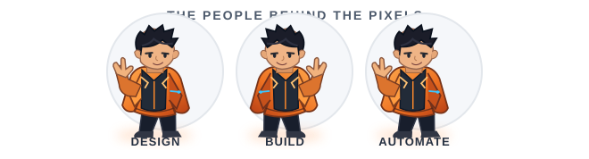
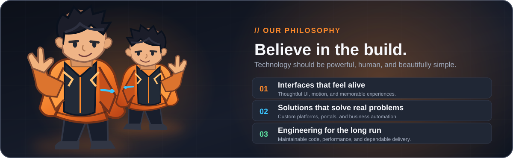
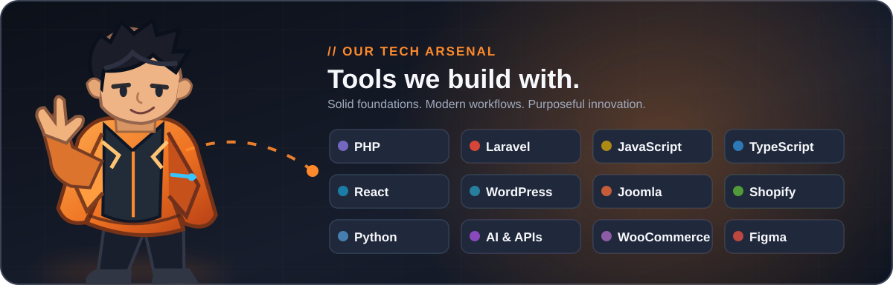
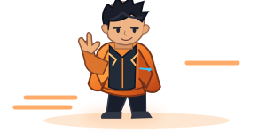
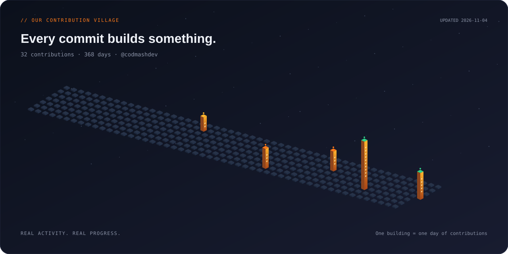
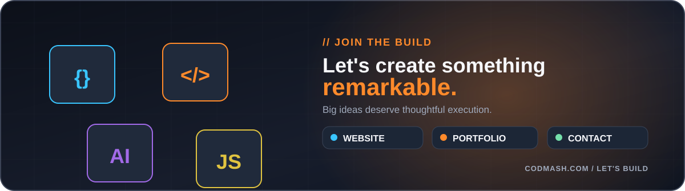

<!-- CINEMATIC CODMASH INTRO -->

  

<!-- MALE MASCOT TEAM, REPLACING ORIGINAL GIRL ARTWORK -->

  

<!-- BRAND PHILOSOPHY: SAME DARK FEATURE PANEL LAYOUT -->

  

<!-- TECH STACK PANEL -->

  

<!-- BRAND IDENTITY AND COMPANY HIGHLIGHTS -->

  

## 🏆 Featured Missions

| Project | What We Built | Expertise | Focus |
| :--- | :--- | :--- | :---: |
| **[Recoup](https://codmash.com/work/)** | Shopify redesign with conversion-focused user experience. | <code>Shopify</code> <code>UI/UX</code> | 🛒 |
| **[Go Factory Finish](https://codmash.com/work/)** | Responsive web experience and performance-focused design. | <code>Web</code> <code>UI/UX</code> | ⚡ |
| **[The Certified Lover Girls](https://codmash.com/work/)** | Shopify eCommerce experience with a distinct brand identity. | <code>Shopify</code> <code>Design</code> | 🎨 |
| **[VibeHuman](https://codmash.com/work/)** | User-focused online shopping experience. | <code>Shopify</code> <code>eCommerce</code> | 🛍️ |
| **[Petme2](https://codmash.com/work/)** | Modern online store and shopping journey. | <code>Shopify</code> <code>Web</code> | 🌐 |

<a href="https://codmash.com/work/"><b>→ Explore Our Portfolio</b></a>

  

### 🌃 Our Contribution City

*Every idea begins a journey. Every build makes it real.*

  

<!-- CONNECT WITH THE STUDIO -->

 

  

 

**Build boldly. Ship thoughtfully. Keep growing.** 🚀

