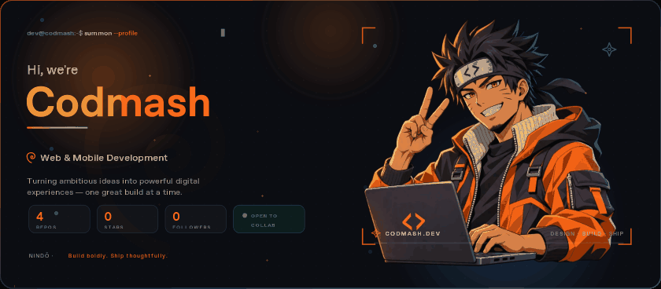
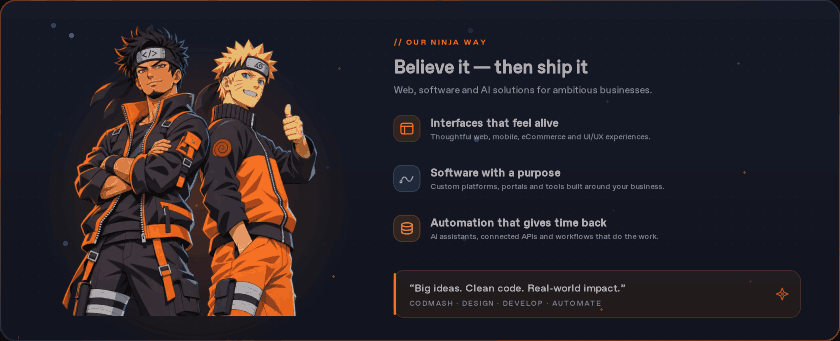
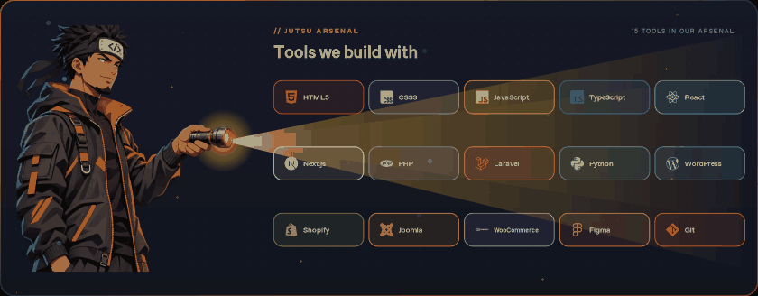
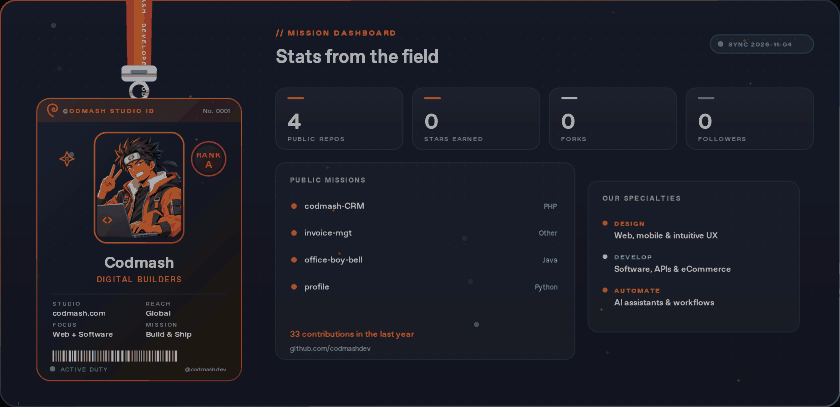
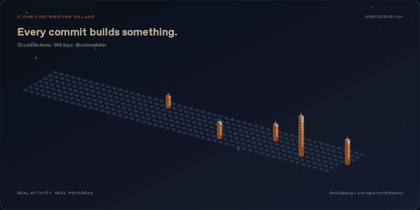
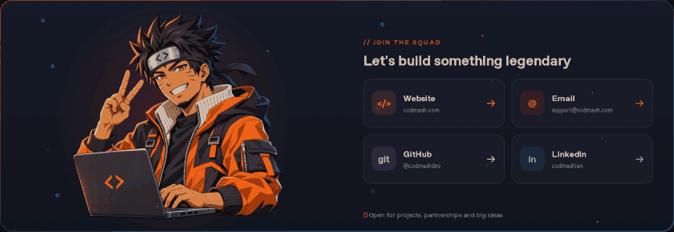

<!-- CODMASH // Animated GitHub Studio Profile -->
<!-- Display assets are GIFs. Editable SVG sources remain under templates/ and assets/. -->

<strong>We turn ambitious ideas into remarkable digital products.</strong>

Thoughtful design. Powerful engineering. Automation that gives people their time back.

  

DESIGN WITH PURPOSE &nbsp; / &nbsp; ENGINEER WITH CARE &nbsp; / &nbsp; SHIP WITH CONFIDENCE

---

## 01 / Believe In The Build

Great software is more than working code. It should feel effortless, solve a real problem, and make its users' lives better. That belief shapes every CodMash project.

| &nbsp; | Our Philosophy | What It Means |
|:---:|---|---|
| 🎨 | **Design For Humans** | Clear journeys, thoughtful interactions, and interfaces people enjoy using. |
| ⚙️ | **Build For The Real World** | Reliable applications, responsive experiences, and maintainable architecture. |
| ⚡ | **Automate What Slows You Down** | Useful AI and workflows that reduce repetitive work and unlock more capacity. |

<a href="https://codmash.com/services/"><strong>Explore What We Build →</strong></a>

 

## 02 / Our Tech Arsenal

Different challenges need different tools. We choose the stack that serves the product.

| Discipline | Technologies & Platforms |
|---|---|
| **Front-End & UI** | `HTML` `CSS` `JavaScript` `TypeScript` `React` `Next.js` |
| **Back-End & Automation** | `PHP` `Laravel` `Python` `APIs` |
| **CMS & eCommerce** | `WordPress` `WooCommerce` `Shopify` `Joomla` |
| **Design & Delivery** | `Figma` `Git` `UX/UI` |

 

## 03 / Studio Identity

<strong>Ideas in motion. Progress you can see.</strong>

Our dashboard uses a checked public GitHub snapshot and refreshes through the profile workflow.

 

## 04 / S-Rank Missions

<em>Selected work from the CodMash portfolio. Different brands, different challenges, one commitment to thoughtful execution.</em>

| Mission | What We Built | Expertise |
|---|---|---|
| **[Recoup](https://codmash.com/work/recoup-shopify-website-redesign-cro/)** | Shopify redesign focused on a more confident, conversion-friendly shopping experience. | `Shopify` `CRO` `UI/UX` |
| **[Go Factory Finish](https://codmash.com/work/go-factory-finish/)** | Responsive website with a performance-conscious visual experience. | `Web` `UI/UX` |
| **[The Certified Lover Girls](https://codmash.com/work/the-certified-lover-girls/)** | Brand-forward eCommerce experience with a distinctive aesthetic. | `Shopify` `Design` |
| **[VibeHuman](https://codmash.com/work/vibehuman/)** | People-centered online shopping interface and journey. | `eCommerce` `Shopify` |
| **[Petme2](https://codmash.com/work/petme2/)** | Modern online store with a thoughtful customer experience. | `Web` `Shopify` |

<a href="https://codmash.com/work/"><strong>VIEW THE FULL PORTFOLIO ↗</strong></a>

 

## 05 / Our Contribution City

<strong>Every commit builds something. Every day moves us forward.</strong>

REAL ACTIVITY &nbsp; · &nbsp; REAL PROGRESS &nbsp; · &nbsp; BUILT ONE COMMIT AT A TIME

 

## 06 / Let's Build Something Legendary

<strong>Have a product idea, a redesign, or a repetitive process worth automating?</strong>

Tell us what you're building. We'd love to help make it real.

  

 

<h3>Build boldly. Ship thoughtfully. Keep growing.</h3>

© CODMASH &nbsp; · &nbsp; BELIEVE IN THE BUILD

<a href="./docs/PROFILE.md">How This Profile Works</a> &nbsp; · &nbsp; <a href="./docs/CREDITS.md">Artwork &amp; Credits</a>

